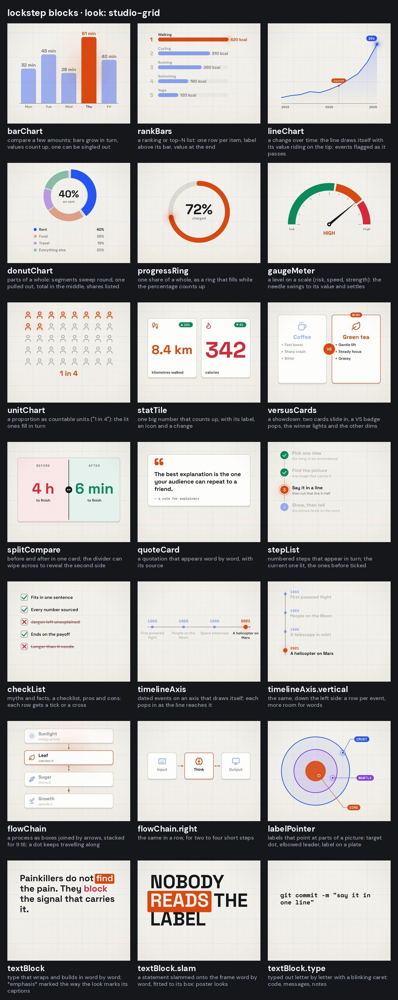

# Ready-made blocks

`engine/anim/js/blocks.js` holds blocks for what explainers draw again and again: charts, big
numbers, comparisons, lists, timelines, quotes, pointers and processes. Each takes on the video's
look — palette roles, fonts, card shapes, soft or hard shadows, and hand-drawn outlines in a
rough look — and builds in with one progress value, so a scene keys it to a spoken word like
anything else.

Use a block when the beat needs exactly that: a share, a ranking, a before and after, three
steps. Draw your own when the picture is the idea; the hero object of a video deserves its own
drawing in `components.js`. A block is a start, not a scene: put it in the brief's visual world
(a camera move, a highlight on the key value, idle motion around it), and keep to one or two per
frame.

## See them in the video's look

```bash
bin/lockstep blocks <slug>                        # every block, finished -> out/blocks.jpg
bin/lockstep blocks <slug> barChart stepList      # their build-in as strips -> out/blocks_strips.jpg
bin/lockstep blocks --style styles/poster-pop.json    # any look, before a video exists
```

Gallery in three looks — light ([studio-grid](blocks/studio-grid.jpg)), dark
([neon-blueprint](blocks/neon-blueprint.jpg)) and hand-drawn ([chalkboard](blocks/chalkboard.jpg)):



## Using one

```js
(window.SCENE_DEFS = window.SCENE_DEFS || []).push(function () {
  const c = { week: at('habits', 'week'), thursday: at('habits', 'thursday'), why: at('habits', 'why') };
  addScene('habits', function (ctx, t) {
    /* the chart builds in over the sentence that introduces it, Thursday lights on its word */
    const bars = barChart(ctx, 120, 420, 840, 700,
      [{ label: 'Mon', value: 32 }, { label: 'Tue', value: 45 }, { label: 'Wed', value: 28 }, { label: 'Thu', value: 61 }, { label: 'Fri', value: 40 }],
      { p: tw(t, c.week - 0.2, c.week + 1.4, E.lin), hi: t >= c.thursday ? 3 : -1, suffix: ' min' });
    /* the returned geometry places a pointer on the tallest bar */
    labelPointer(ctx, bars[3].cx, bars[3].y, 760, 400, 'WHY?', { p: tw(t, c.why, c.why + 0.6, E.lin), t });
  });
});
```

- **`o.p`** (0 → 1) builds the block in. Use `tw(t, a, b, E.lin)` keyed to cues: the block eases
  its parts itself. Several blocks in turn: `stagger(p, i, n)`.
- **`o.hi`** or **`o.active`** singles out one part: an index, which may change on a word.
- **Colours are roles**: `color: 'alert'`, `colors: ['data', 'accent']`; lint warns on a name that
  is not one.
- **Numbers** count up during the build-in and keep the final value's decimals; format with
  `prefix`, `suffix`, `decimals` (`numText(v, o)` does the same in a scene).
- **`o.t`** (pass the scene's `t`) gives the blocks that have one their idle motion: the active
  step's ring breathes, the dot travels along a flow, a pointer's target pulses.
- Every block returns its geometry: bar boxes, segment mid-points, badge centres, box corners.
- Text is 24 px or larger. Placement is still yours: run `lockstep lint` (safe zones, captions,
  overlaps, contrast) and look at the frames.

## The blocks

| Block | For | Options beyond `p` |
|---|---|---|
| `barChart(ctx, x, y, w, h, bars, o)` | a few amounts side by side; bars grow in turn, values count up | `hi`, `max`, `color`, `prefix`/`suffix`/`decimals`, `labelSize`, `valueSize`, `gap` |
| `rankBars(ctx, x, y, w, items, o)` | a ranking or top-N list, one row per item | `hi`, `rank`, `sort`, `max`, `rowH`, `barH`, number format |
| `lineChart(ctx, x, y, w, h, values, o)` | a change over time; the value rides on the tip | `color`, `min`, `max`, `area`, `grid`, `xLabels`, `marks: [{ i, label }]`, `tip`, number format |
| `donutChart(ctx, cx, cy, r, parts, o)` | parts of a whole; one pulled out | `hi`, `thick`, `center: { value, label, suffix }`, `legend`, `colors` |
| `progressRing(ctx, cx, cy, r, share, o)` | one share (0–1) as a filling ring | `color`, `thick`, `label`, `decimals` |
| `gaugeMeter(ctx, cx, cy, r, value, o)` | a level on a scale; the needle overshoots and settles | `zones: [{ to, color }]`, `label`, `minLabel`, `maxLabel`, `thick` |
| `unitChart(ctx, x, y, w, n, k, o)` | "1 in 4", "38 of 100" as countable units | `icon`, `cols`, `pick: [indices]`, `color`, `label` |
| `statTile(ctx, x, y, w, h, value, label, o)` | one big number with its label | `icon`, `color`, `delta: '+12%'`, `deltaGood`, `align`, `hi`, number format |
| `versusCards(ctx, x, y, w, h, a, b, o)` | a showdown; `a`, `b`: `{ title, rows, icon, color }` | `win: 'a' \| 'b'`, `winLabel`, `badge` |
| `splitCompare(ctx, x, y, w, h, left, right, o)` | before and after in one card; `{ tag, value, sub, color }` | `split` (animate 1 → 0.5 to wipe the second side in) |
| `quoteCard(ctx, x, y, w, quote, who, o)` | a quotation, word by word | `size`, `card`, `color` |
| `stepList(ctx, x, y, w, items, o)` | numbered steps; strings or `{ title, sub }` | `active`, `done`, `rowH`, `color`, `t` |
| `checkList(ctx, x, y, w, items, o)` | ticks and crosses: `[{ text, ok }]` | `strike`, `rowH`, `size` |
| `timelineAxis(ctx, x, y, w, events, o)` | dated events: `[{ at, text }]` | `active`, `vertical` (a row per event: more room for words), `rowH`, `color` |
| `flowChain(ctx, x, y, w, nodes, o)` | a process: `[{ label, sub, icon }]` joined by arrows | `dir: 'down' \| 'right'`, `active`, `boxH`, `gap`, `t` |
| `labelPointer(ctx, tx, ty, lx, ly, label, o)` | point at a part of a picture: target dot, elbowed leader, label on a plate | `color`, `size`, `t` |

The gallery also shows the type styles of `textBlock` (`textBlock`, `textBlock.slam`,
`textBlock.type`); type and narration-synced type are in scene-api.md, "Type that moves".

Helpers, usable in any scene: `blockCard(ctx, x, y, w, h, { alpha, accent, fill })` (a card in the
look's shape language, hand-drawn in a rough look), `numText(v, { prefix, suffix, decimals, of })`
and `stagger(p, i, n, spread)`.

## How a look changes them

| style.json | Effect on the blocks |
|---|---|
| `palette` roles | every colour; series take subject, accent, data, good, alert in turn |
| `fonts` | values and titles in the display face, labels in the body face, dates and tags in mono |
| `shape.radius`, `stroke`, `panelAlpha`, `shadow` | cards and bar corners, as `panel()` draws them; hard offset shadows in poster looks |
| `shape.line: "rough"` | hand-drawn outlines on cards, bars, axes and connectors (chalk, notebook, marker looks) |
| `mode: "light"` | glows become tints; fills under lines lighten |

Charts carry numbers: every value on screen still needs its source in `docs/sources.md`, and the
demo numbers in the gallery are made up.
