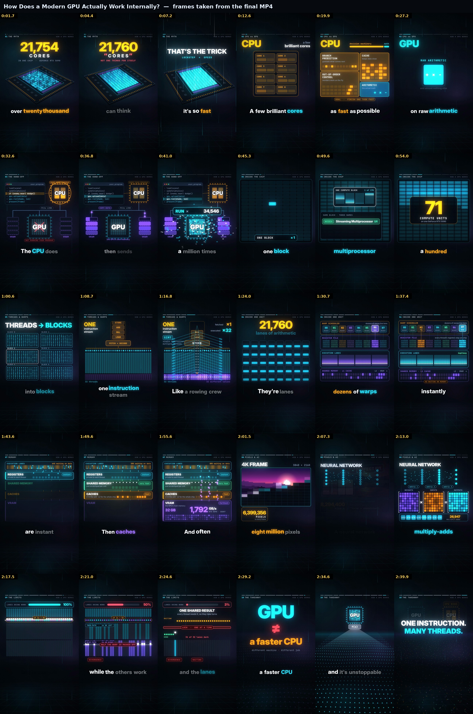

# lockstep-studio

Turn a topic into a finished vertical explainer video — voiceover, animation, original music,
sound design and word-synced captions — rendered entirely by code, on one machine, with no paid
services.

- **Output:** 1080 × 1920 (9:16), 30 fps, H.264 + AAC MP4, −14 LUFS, ready for Instagram Reels
  and YouTube Shorts, plus an SRT file, a storyboard, a sourced script and a QA report.
- **Method:** the narration is recorded first. The voice model reports when each word is spoken,
  and every animation, sound effect and caption looks its time up by spoken word. Picture and
  voice stay in lockstep because there is only one clock.
- **Made to be driven by Claude Code:** the repository carries a skill that holds the whole
  production process. You ask for a video; it researches, writes, records, animates, mixes,
  renders and checks it.

The reference production, [`videos/how-a-gpu-works/`](videos/how-a-gpu-works/), is a 162-second
video built this way: 390 spoken words, 10 chapters, 34 storyboard sequences, 235 sound cues.



## Make a video

Open the repository in Claude Code (terminal, desktop, or claude.ai/code) and ask:

> Make an explainer video about how mRNA vaccines work.

The `explainer-video` skill takes it from there. Useful things to add to the request: target
length (default 150–170 s), audience, anything that must or must not be covered, a preferred
voice. To revise: "in the vaccine video, make the hook punchier" or "chapter 4 is too dense".

The finished files land in `videos/<slug>/dist/` and `videos/<slug>/docs/`.

## Setup

Needs Python 3.10+, Node 18+ with Playwright and Chromium, FFmpeg, and network access to PyPI and
GitHub release downloads.

```bash
bin/lockstep setup --with-asr
```

```bash
bin/lockstep doctor
```

```bash
scripts/selftest.sh
```

`setup` installs the Python packages, downloads the voice model (≈ 350 MB) into `models/`, and
installs the fonts if they are missing. `--with-asr` adds speech-recognition models (≈ 450 MB
kept) used to check that the voice says what the script says. `selftest.sh` builds the bundled
template video end to end in about two minutes.

**Claude Code on the web:** a cloud session starts from a fresh container, so the models are not
there until `setup` runs. Either let the skill run it at the start of a session (3–5 minutes), or
put this in your cloud environment's setup script so every session starts ready:

```bash
if [ -d lockstep-studio ]; then (cd lockstep-studio && bash scripts/setup.sh --with-asr) || true; fi
```

## How it works

```
script.py ──► voice ──► words.json (every word, to 25 ms) ──┬─► scenes/*.js ──► frames ──┐
                │                                           ├─► captions                 ├─► MP4
                │                                           └─► sound cues ─► score+mix ─┘
                └─► narration.wav ───────────────────────────────────────────────┘
```

| Stage | How |
|---|---|
| Voice | Kokoro-82M text-to-speech, run locally. The ONNX graph is patched to output its phoneme durations, so word timings are exact rather than estimated. |
| Animation | HTML Canvas 2D. Each scene is a JavaScript function of time; cues are `at('beat', 'word')`. |
| Rendering | Headless Chromium draws every frame deterministically across four workers (≈ 40 fps). |
| Music and sound | Synthesised in NumPy: pads, bass, arpeggio and drums arranged per chapter; 24 sound-effect types triggered by the scenes at the same cues as the picture. |
| Mix and master | Voice processing, ducking under speech, look-ahead limiter, −14 LUFS. |
| Encode | FFmpeg libx264 (CRF 16, BT.709), AAC 256 kbps, streamable MP4. |
| QA | Stream facts, full decode, black-frame and freeze detection, SSIM against the rendered frames, loudness, audio/picture sync, speech recognition on the final mix, caption geometry, contact sheet and phone-size previews. |

## Commands

```
bin/lockstep new <slug> ["Title"]     scaffold videos/<slug>/ from the template
bin/lockstep voice <video>            record the narration, extract word timings
bin/lockstep check-voice <video>      transcribe it back and compare with the script
bin/lockstep words <video> [beat]     list every spoken word with its time
bin/lockstep captions <video>         check (or --draft) the caption chunking
bin/lockstep still|sheet|scan <video> review frames while designing
bin/lockstep build <video>            everything from scenes to validated MP4, docs and verdict
bin/lockstep help                     the full list
```

## Layout

```
bin/lockstep                 command-line entry point
engine/                      renderer, voice, score and mix, encode, QA — shared by all videos
templates/video/             starter project copied by `lockstep new`
videos/<slug>/               one folder per video (sources, data, docs, dist)
.claude/skills/explainer-video/   the production process Claude follows
scripts/setup.sh  selftest.sh
```

A video's own files are small and readable: `script.py` (narration), `scenes/*.js` (one per
chapter), `video.json` (chapter names and music moods), `caption_phrases.json`, `storyboard.py`,
`docs/sources.md`.

## What is and is not in git

Models, rendered frames, audio stems and finished MP4s are ignored (an MP4 of this quality is over
GitHub's 100 MB file limit). Everything needed to rebuild a video is committed:

```bash
bin/lockstep voice how-a-gpu-works
```

```bash
bin/lockstep build how-a-gpu-works
```

Rebuilds are deterministic: the same script gives the same audio and timings, and the same scenes
give byte-identical frames.

## Limits

- English narration only, with the voices that ship with the model.
- One visual style (dark, glowing line art). It is tuned for phone screens and for the encoder;
  restyling means editing `engine/anim/js/`.
- The agent cannot listen to the mix or watch playback inside the apps. Audio is verified by
  measurement and speech recognition; watch each video once yourself before publishing.
- Facts are only as good as the research step. Read `docs/sources.md` and the accuracy review in
  the production report.

## Third-party components

Downloaded at setup, not stored here: Kokoro-82M voice model and `kokoro-onnx` (Apache-2.0 / MIT),
`misaki` (Apache-2.0), sherpa-onnx with Whisper small.en and a Zipformer model (optional QA),
Inter and JetBrains Mono typefaces (SIL Open Font License). FFmpeg, Chromium and Playwright are
used as installed tools. Music and sound effects are generated by this code and are original.
